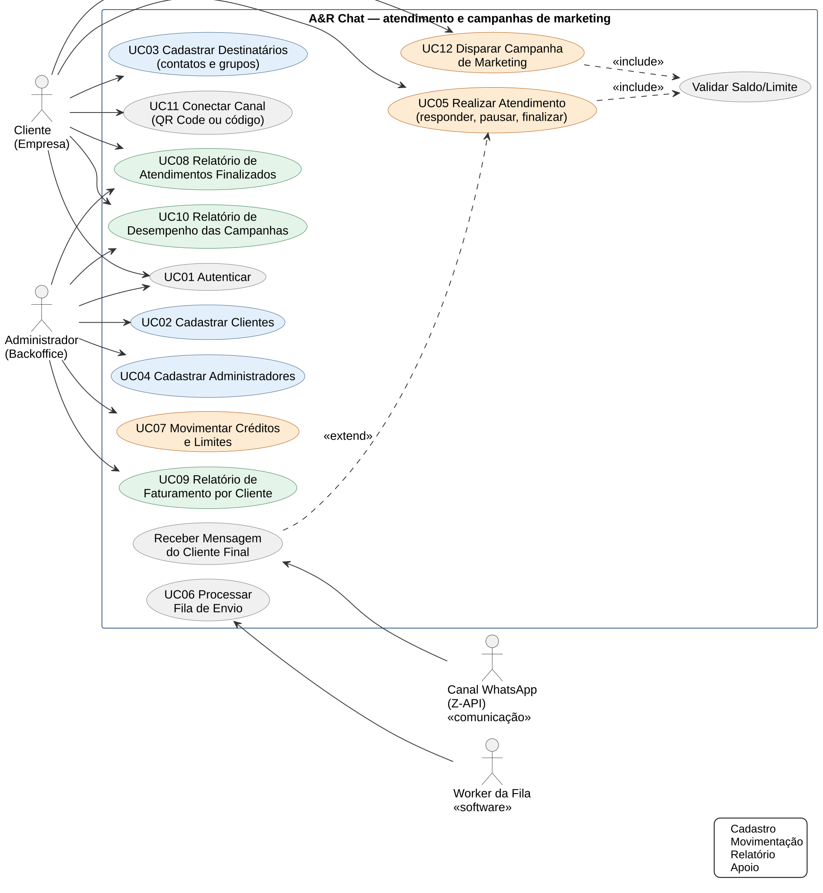
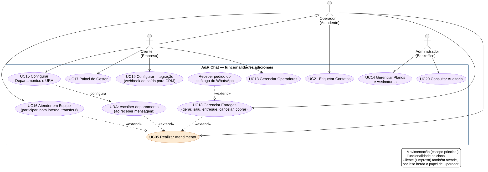
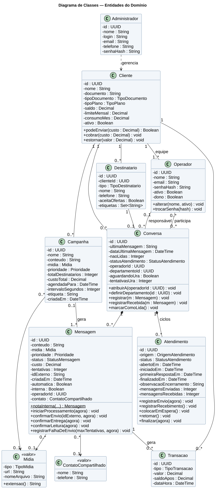
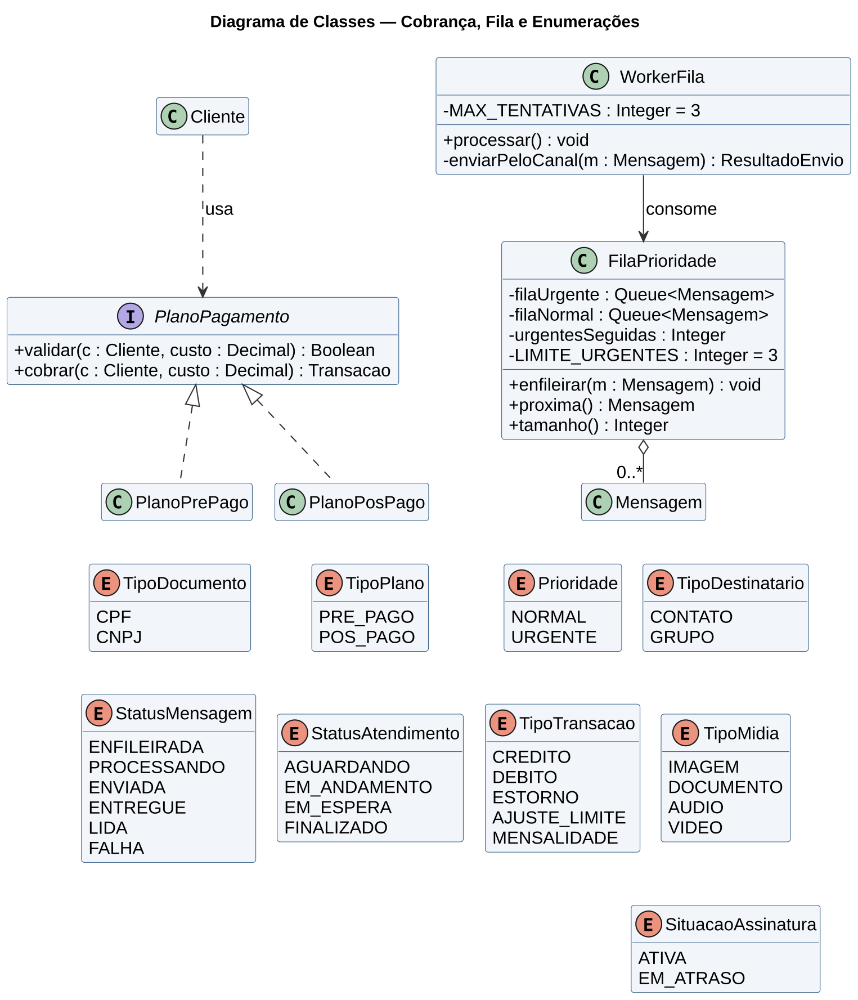
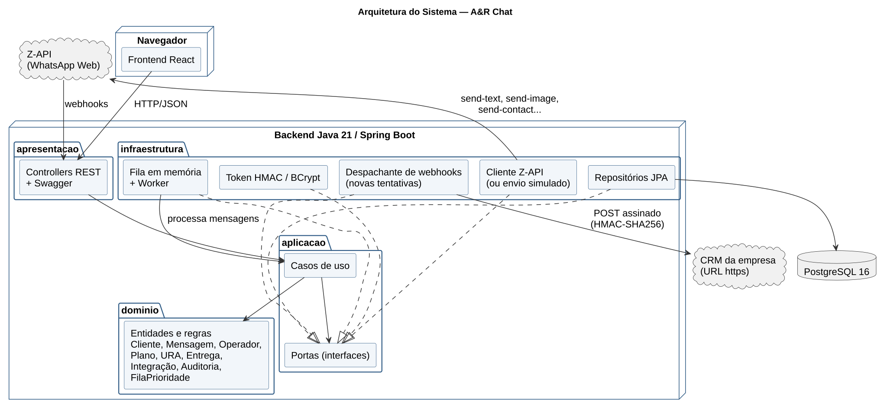
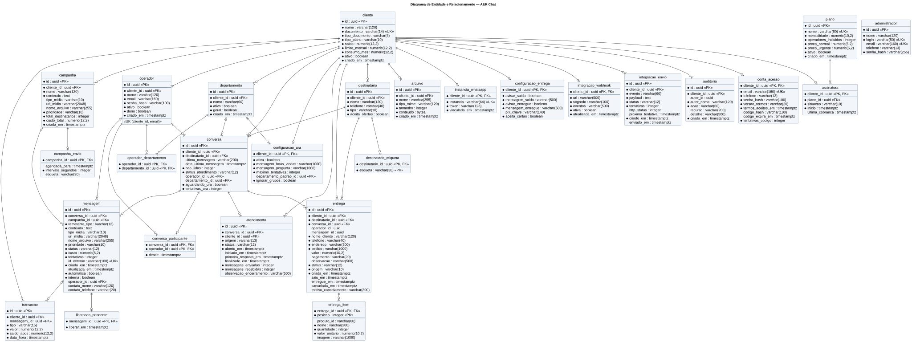
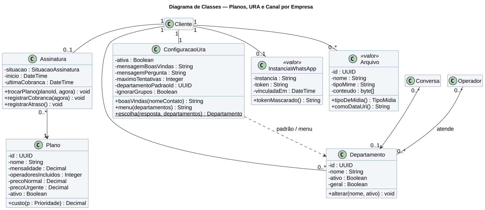

# A&R Chat — Backend

Plataforma web para empresas **gerenciarem o atendimento aos clientes pelo WhatsApp** e **dispararem campanhas de
marketing**. As conversas ficam numa tela única, separadas pelo status do atendimento (aguardando, em andamento,
em espera e finalizado); cada mensagem enviada é cobrada (pré-pago ou pós-pago) e passa por uma fila com prioridade.

O painel web fica no repositório [ar-chat-frontend](https://github.com/ryanandrade-beep/ar-chat-frontend).

## Estrutura do projeto

```
ar-chat-backend/
├── backend/                      API REST — Java 21 + Spring Boot 4, arquitetura limpa
├── docs/
│   ├── 01-documento/             Entrega do Documento Final até Especificações de Requisitos.docx
│   ├── 02-apresentacao/          Apresentação do Estágio I (.pptx, modelo UMFG)
│   ├── 03-diagramas/             Casos de uso, classes, estados, atividades, sequência, DER, arquitetura (PNG)
│   ├── 04-prototipos/            Protótipos das telas: atendimento, canal, campanha (PNG)
│   ├── 05-postman/               Collection e ambiente do Postman (login automático)
│   └── fontes/                   Fontes PlantUML dos diagramas, gerador do documento e script dos diagramas
├── docker-compose.yml
└── .env.example                  Variáveis (copie para .env — o .env não vai para o Git)
```

## Escopo: 3 cadastros, 3 movimentações, 3 relatórios

| Tipo | Funcionalidades |
|---|---|
| Cadastros | Clientes · Destinatários (contatos e grupos do WhatsApp) · Administradores |
| Movimentações | **Realizar Atendimento** (responder, colocar em espera, retomar, finalizar) · **Disparar Campanha de Marketing** · Movimentar Créditos e Limites |
| Relatórios | **Atendimentos Finalizados** · Faturamento por Cliente · Desempenho das Campanhas (todos exportam CSV) |
| Apoio | Criar conta, login por e-mail e senha e recuperação de senha · Fila de envio com prioridade (worker) · Receber mensagens (webhook) · Canal: **WhatsApp Web** (Z-API) e WhatsApp Business (**em breve**) |

### Funcionalidades adicionais

Além do escopo principal, o sistema já tem:

| Funcionalidade | O que faz |
|---|---|
| **Três tipos de acesso** | Backoffice (donos do A&R Chat), administrador da empresa e operador. O operador não cria a própria conta: quem cria é o administrador da empresa |
| **Operadores** | Cada empresa tem a sua equipe de atendentes com login próprio, dentro do limite do plano |
| **Planos** | O backoffice cria planos com mensalidade, operadores incluídos e preço por mensagem, e vincula cada empresa a um plano |
| **Departamentos e URA** | Menu automático em que o cliente final escolhe o departamento; depois das tentativas, a conversa vai para o departamento padrão |
| **Atendimento em equipe** | Participar de um atendimento em andamento, notas internas (não vão para o WhatsApp) e transferência com recado |
| **Painel do gestor** | Atendimentos por status, média da primeira resposta, atendimentos por dia e por operador e contatos mais frequentes |
| **WhatsApp por empresa** | Cada empresa usa a sua instância da Z-API; só o administrador da empresa conecta o número |
| **Arquivos, contato e áudio** | Envio de arquivos do computador, de contatos e de áudio gravado pelo microfone |
| **Tema claro e escuro** | Alternância no painel e no chat |
| **Contatos com etiquetas** | Etiquetas coloridas com autocomplete; filtro por etiqueta no chat e nas campanhas |
| **Campanhas programadas** | Data de início, intervalo entre envios, filtro por etiqueta e por data, métricas de entrega e falha |
| **Encerramento do atendimento** | Encerrar no departamento ou enviar ao departamento **Geral** (padrão, não editável), com observação; o Geral recebe tudo o que não escolheu departamento na URA |
| **Operadores por departamento** | Cada operador atende os departamentos vinculados; e-mail único por empresa e validação do nome |
| **Exportação** | Dashboard e relatórios exportam **CSV, Excel e PDF** com filtros e colunas à escolha: atendimentos, campanhas, **histórico de pagamentos** e contatos |
| **Histórico do ticket** | Cada atendimento finalizado tem a conversa completa, exportável |
| **Entregas** | O operador gera a entrega ao encerrar (endereço, produtos do catálogo ou texto, valor e pagamento); o responsável confirma **saiu** e **entregue**, cancela, edita e acompanha tempo médio e em trânsito. O cliente é avisado no WhatsApp (mensagens editáveis e chave Pix) |
| **Catálogo do WhatsApp Business** | Lista os produtos do catálogo da instância, recebe o carrinho do cliente como **cartão "Seu pedido"** no chat (fotos, preço e quantidade) e vira entrega; envia a cobrança com Pix e atualiza o status nativo do pedido (`shipped`/`completed`), com texto como alternativa |
| **Integrações (webhook de saída)** | O responsável cadastra a URL do CRM e escolhe os eventos (`message.received`, `attendance.started`, `attendance.finished`, `delivery.dispatched`, `delivery.delivered`). Formato próprio do A&R Chat (sem nada da Z-API), assinatura HMAC-SHA256, novas tentativas e histórico com reenvio |
| **Auditoria (suporte)** | O backoffice vê quem fez o quê e quando em cada empresa (login, operadores, atendimentos, entregas, campanhas, integração), com filtro por empresa (nome ou ID), ação, período e busca, e exporta em CSV |
| **Histórico de pagamentos** | Na tela Assinatura: recargas de crédito e mensalidades dos últimos 12 meses, exportáveis |

Nenhuma movimentação depende da Z-API: ela é só o canal que entrega as mensagens e avisa respostas, entregas e leituras.

As mensagens podem ser de texto, de contato ou levar **imagem, documento (PDF etc.), áudio ou vídeo**, informados pelo
link público do arquivo ou enviados do computador (o texto vira a legenda). O preço é o mesmo de uma mensagem de texto. Campanhas também aceitam mídia (ex.: o
encarte de ofertas em imagem).

### Rotas da Z-API usadas

| A&R Chat | Z-API | Para quê |
|---|---|---|
| Fila de envio (texto) | `POST /send-text` | Enviar texto |
| Fila de envio (mídia) | `POST /send-image`, `/send-document/{extensão}`, `/send-audio`, `/send-video` | Enviar mídia (link ou base64) |
| Fila de envio (contato) | `POST /send-contact` | Enviar um contato |
| `GET /recipients/whatsapp-contacts` | `GET /contacts` | Importar contatos da agenda |
| `GET /catalog/products` | `POST /catalogs` | Produtos do catálogo (preços vêm em milésimos) |
| `POST /deliveries/{id}/charge` | `POST /send-order` | Cobrança com Pix e cartão |
| `POST /deliveries/{id}/dispatch` e `/deliver` | `POST /order-status-update` | Status nativo do pedido (`shipped`, `completed`) |
| Inicialização do backend | `PUT /update-webhook-received` e `/update-webhook-message-status` | Aponta os webhooks para `ARCHAT_URL_PUBLICA` |
| `GET /whatsapp/status` | `GET /status` | Situação da conexão |
| `GET /whatsapp/qr-code` | `GET /qr-code/image` | Conectar por QR Code |
| `GET /whatsapp/phone-code/{telefone}` | `GET /phone-code/{phone}` | Conectar por código no telefone |
| `GET /whatsapp/groups` | `GET /groups` | Listar grupos |
| `POST /whatsapp/disconnect` | `GET /disconnect` | Desconectar |
| `POST /conversations/{id}/read` | `POST /read-message` | Marcar como lida no WhatsApp |
| `POST /webhooks/zapi/{segredo}/received` | Webhook "Ao receber" | Mensagens recebidas (texto e mídia) |
| `POST /webhooks/zapi/{segredo}/status` | Webhook "Status da mensagem" | Entregue / lida |
| Webhook "Ao receber" (`order`, `reviewOrder`, `reviewAndPay`) | Pedido do carrinho do catálogo e referências do pedido nativo |

## Como executar

Pré-requisitos: Java 21 e Docker (Colima neste Mac: `colima start`).

```bash
# 1. Banco PostgreSQL na porta 5433 (as tabelas são criadas pelo Flyway na primeira execução)
docker run -d --name archat-postgres --restart unless-stopped -e POSTGRES_DB=archat -e POSTGRES_USER=archat \
  -e POSTGRES_PASSWORD=archat -p 5433:5432 -v archat-dados-postgres:/var/lib/postgresql/data postgres:16-alpine

# 2. API
cd backend
./mvnw spring-boot:run
```

```bash
# 3. Painel web (outro terminal), no repositório ar-chat-frontend
cd ../ar-chat-frontend
npm install
npm run dev      # http://localhost:5173 — crie uma conta em "Criar conta" ou entre como administrador
```

- API e Swagger: http://localhost:8080 (abre o Swagger) — admin inicial `admin` / `admin12345`
- Banco no DBeaver: `localhost:5433`, base `archat`, usuário `archat`, senha `archat`
- Postman: importe os dois arquivos de `docs/05-postman` e rode a collection (login automático)

Scripts em `scripts/` (cada um sobe uma parte, para rodar backend e frontend em abas separadas do terminal):

```bash
scripts/backend.sh    # backend com as variáveis do .env (porta 8081)
scripts/frontend.sh   # painel em http://localhost:5173
scripts/tunel.sh      # túnel temporário (cloudflared); mostra a ARCHAT_URL_PUBLICA a usar
NGROK_DOMINIO=seu-nome.ngrok-free.dev scripts/tunel-fixo.sh   # túnel com endereço fixo (ngrok)
```

### Envio real pelo WhatsApp (Z-API)

No `.env` da raiz: `ARCHAT_ENVIO_PROVEDOR=zapi`, `ARCHAT_ZAPI_URL`, `ARCHAT_ZAPI_INSTANCIA`, `ARCHAT_ZAPI_TOKEN`,
`ARCHAT_ZAPI_CLIENT_TOKEN`. Sem isso, o envio é **simulado** (padrão, ideal para testes e demonstração).

Webhooks (a Z-API exige HTTPS — em desenvolvimento, use um túnel como o `cloudflared`):
- Ao receber: `https://SEU-ENDERECO/webhooks/zapi/<ARCHAT_WEBHOOK_SEGREDO>/received`
- Status da mensagem: `https://SEU-ENDERECO/webhooks/zapi/<ARCHAT_WEBHOOK_SEGREDO>/status`

Com `ARCHAT_URL_PUBLICA=https://SEU-ENDERECO` (no `.env`), o backend aponta os webhooks de todas as instâncias para esse
endereço **a cada partida**, sem mexer no painel da Z-API. Para o endereço não mudar, use um túnel fixo (`scripts/tunel-fixo.sh`).

Sem webhook, dá para demonstrar o atendimento com `POST /conversations/{id}/simulate-reply`.

### Webhook de saída (integração com CRM)

Em **Integrações**, o responsável informa uma URL `https` pública e marca os eventos. Cada aviso é um `POST` em JSON:

```json
{ "id": "…", "event": "attendance.finished", "occurredAt": "2026-11-25T20:12:47Z",
  "data": { "attendanceId": "…", "conversationId": "…", "contact": { "name": "…", "phone": "…" },
            "operator": { "id": "…", "name": "…" }, "department": "Geral", "closingNote": "…" } }
```

Cabeçalhos: `X-ArChat-Event`, `X-ArChat-Delivery`, `X-ArChat-Timestamp` e `X-ArChat-Signature` =
`sha256=` + HMAC-SHA256 de `"{timestamp}.{corpo}"` com o segredo da integração. Se o CRM falhar, há novas tentativas
(30 s, 2 min e 10 min); depois o envio fica como *falhou* e pode ser reenviado pelo painel. URLs internas
(`localhost`, IPs privados) são recusadas.

### Dados fictícios para demonstração

```bash
C=$(docker ps -qf publish=5433 | head -1)
docker exec -i $C psql -U archat -d archat < scripts/dados-demo.sql                         # contatos, atendimentos e campanhas
docker exec -i $C psql -U archat -d archat < scripts/dados-demo-entregas.sql                # entregas, pedidos do catálogo e integração
docker exec -i $C psql -U archat -d archat < scripts/dados-demo-auditoria.sql               # auditoria do Cliente Teste QR
docker exec -i $C psql -U archat -d archat < scripts/dados-demo-auditoria-outras-empresas.sql
docker exec -i $C psql -U archat -d archat < scripts/limpar-dados-demo.sql                  # remove o primeiro grupo
docker exec -i $C psql -U archat -d archat < scripts/limpar-dados-demo-entregas.sql         # remove entregas, integração e auditoria de exemplo
```

Os scripts de exemplo foram escritos para o banco desta máquina (ids da empresa e dos operadores no próprio arquivo).

### Testes

```bash
cd backend && ./mvnw verify   # unitários, arquitetura (ArchUnit) e integração (H2) — nunca usam a Z-API real
```

### Diagramas e documento

```bash
docs/fontes/gerar-diagramas.sh /caminho/plantuml.jar   # regenera 03-diagramas e 04-prototipos
```

## Diagramas

### Casos de uso


### Casos de uso – funcionalidades adicionais


### Estados do atendimento


### Atividades – enviar resposta do atendimento


### Sequência – enviar uma resposta


### Sequência – processar a fila e confirmar a entrega


### Estados da mensagem


### Classes – entidades do domínio


### Classes – cobrança, fila de envio e enumerações


### Arquitetura


### Modelo de entidade e relacionamento


### Protótipos


## Arquitetura

```
apresentacao   → controllers REST, DTOs (JSON em inglês), token Bearer, webhooks, erros, CSV
infraestrutura → JPA/PostgreSQL, fila em memória + worker, envio (simulado ou Z-API), HMAC, BCrypt
aplicacao      → casos de uso e portas (interfaces) — Java puro
dominio        → regras: Cliente e planos (Strategy), Mensagem e Atendimento (máquinas de estado), FilaPrioridade
```

As dependências apontam sempre para dentro; o teste `ArquiteturaLimpaTest` falha se essa regra for quebrada.

### Decisões técnicas

- **Atendimento**: cada conversa tem ciclos de atendimento com status próprio; mensagem do cliente final abre ou
  volta para "aguardando", resposta da empresa põe "em andamento". Campanha de marketing não abre atendimento.
- **Fila com prioridade e anti-starvation**: urgentes primeiro, uma normal a cada 3 urgentes; O(1).
- **Consistência financeira**: cobrança, transação e mensagem na mesma transação, com bloqueio do cliente
  (`SELECT … FOR UPDATE`); 3 tentativas (contando a primeira) e estorno na falha definitiva.
- **Campanhas**: tudo ou nada, até 1.000 contatos, só com consentimento (LGPD); pausa configurável entre envios.
- **Canal como porta** (`EnvioMensagemGateway`): simulado ou Z-API; o WhatsApp Business entra como novo adaptador.

### Limitações / próximos passos

- Token JWT padrão (RFC 7519) — hoje o token é assinado com HMAC-SHA256 num formato próprio.
- Envio de e-mail real (SMTP) — hoje o código de recuperação de senha vai para o log.
- Chave de idempotência no envio (evitar cobrança duplicada em reenvio da mesma requisição).
- Canal WhatsApp Business (API oficial) — "em breve".
- Upload dos arquivos de mídia pelo painel — hoje a mídia é informada por link público.

### Classes – entidades do domínio


### Classes – planos, departamentos, URA e canal por empresa


### Arquitetura


### Entidade e relacionamento (DER)

